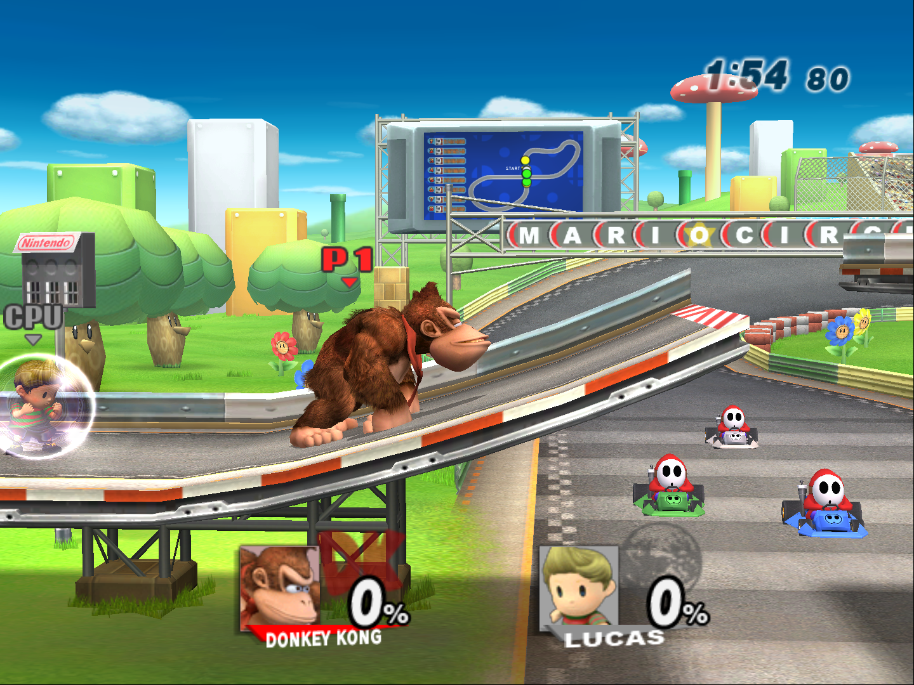

# Brawl Recompiled

A native PC port of **Super Smash Bros. Brawl** (Wii, 2008), made by statically recompiling the game's PowerPC code
(main.dol and all 126 `.rel` modules) to C++ with [WiiCompiled](https://github.com/patchzyy/Wiicompiled). No
emulator: the game runs as a Windows program.



**Work in progress.** What works today: boot, saves, every menu tested so far, VS battles, the attract demos,
Classic mode's start, and the Subspace Emissary's opening (cutscenes and the first battle). Project+ loads from the
virtual SD card up to its character and stage select; its matches still crash while loading (being worked on).

## Features

- Up to 4K, and the game's own 16:9 mode (plus fill-the-window for ultrawide)
- 120 fps frame interpolation (experimental on Brawl; needs a display faster than 60 Hz)
- Every gamepad is a GameCube controller (Xbox, PlayStation and Nintendo layouts), the keyboard too; real Wii
  Remotes over Bluetooth
- A launcher that installs the game from your own disc image (.iso, .ciso, .wbfs), with the display, controller
  and mod settings, and Wii / Dolphin save import
- Saves in `UserData\NAND`, compatible in layout with a Wii's
- A virtual SD card (`UserData\SD`), so the game's own SD features and SD-based mods work
- Gecko codes and Project+-style mods (in progress, see below)
- Windows and Linux

**No game data is included**: the game's files are read from your own copy of the game.

## Mods

Brawl mods are installed the way they are on a Wii's SD card:

- **The SD card** is the folder `Play\UserData\SD`. Copy a mod's SD card contents into it (for Project+: the
  `Project+`, `private` and `apps` folders from the Wii download). At start the game gets a card image built from
  that folder the way Dolphin builds one (FAT32, the contents plus 512 MiB to 8 GiB of free space;
  `UserData\Cache\sd_card.raw`, rebuilt only when the folder changes); files the game writes to the card are
  copied back into the folder when it exits. A card over 2 GiB is an SDHC card, which Brawl reads only with a
  mod's SDHC support (Project+ has it). A Dolphin `sd.raw` placed at `UserData\sd.raw` is used directly instead.
- **Gecko codes**: the `RSBE01.GCT` of the card folder chosen on the launcher's Mods page ("Codes to load",
  `[mods] sd_codes` in `Config.toml`), else the first folder with one (`UserData\SD\Project+\RSBE01.GCT`), else
  `UserData\Codes\RSBE01.gct`, is installed with USB Loader GX's code handler, honouring a `gc.txt` beside it
  (code list address, hook type, pokes) exactly as Project+'s loader does. Builds that share the card this way:
  Project+ and [Project+Ex](https://github.com/KingJigglypuff/project-plus-ex) (its `P+Ex`, `apps` and `private`
  folders).
- Code the codes patch runs in a built-in PowerPC interpreter; everything else stays native. Mods that replace
  `.rel` modules (Project+ replaces every fighter) currently run those modules in the interpreter as well.

## Building from source

You need Windows, Python 3, 16 GB of RAM and your own disc image (USA, RSBE01). The toolchain is shared with the
Super Paper Mario port's `toolchain\` folder.

```powershell
# Extract your disc image to Disc\DATA, then:
copy Disc\DATA\sys\main.dol game\main.dol
# Every module pre-linked at its home, plus main_translate.dol (main.dol with the resident modules and the
# Gecko code handler) for the translation:
python wiicompiled\projects\brawl\tools\build_modules.py Disc\DATA\files\module extras\brawl-decomp\config\RSBE01_02 game\brawl_modules.rel wiicompiled game\main.dol
powershell -ExecutionPolicy Bypass -File tools\build-brawl.ps1 -SkipTools
```

`build-brawl.ps1` translates the game and compiles it into `Play\SuperSmashBrosBrawl.exe` and
`Play\engine_usa.dll` (`-SkipTranslate` recompiles only the runtime). The function map comes from the
[Brawl decompilation](https://github.com/doldecomp/brawl), cloned into `extras\brawl-decomp`.

The release (`Brawl Recompiled.exe` plus a hidden `engine\` folder) is made by `tools\build-launcher.ps1` (the
launcher, Windows and Linux, with a portable .NET SDK) and `tools\package-brawl.ps1 -Zip`; `tools\build-linux.sh`
and `tools\package-linux.sh` make the Linux download in WSL from the same translation.

| Folder | What it is |
|---|---|
| `wiicompiled/translator` | PowerPC to C++ static recompiler (C#) |
| `wiicompiled/runtime` | Runtime and Wii SDK HLE (OS, DVD, NAND, SD, WPAD/KPAD, AX audio, VI, GX) |
| `wiicompiled/aurora-main` | Aurora: Wii GX on WebGPU (Dawn / Direct3D 12) |
| `wiicompiled/projects/brawl` | This game's project: function map, module layout, code handler, tools |
| `launcher` | The launcher (WinForms; `linux\` is the same pages in Avalonia) |
| `tools` | Build and packaging scripts |

## Credits

- **Port:** JosiahG
- **[WiiCompiled](https://github.com/patchzyy/Wiicompiled)** (the recompiler and runtime) by patchzyy and
  contributors, GPLv3
- **Aurora** by Luke Street, MIT; Dawn, SDL3 and the other components listed in
  [`wiicompiled/THIRD-PARTY-NOTICES.md`](wiicompiled/THIRD-PARTY-NOTICES.md)
- **Gecko code handler:** USB Loader GX's `codehandleronly` (Gecko OS), GPL
- **[FatFs](http://elm-chan.org/fsw/ff/)** by ChaN (the SD card image), 1-clause BSD
- **Dolphin Emulator** for the reference behaviour of the SD slot and data files (DSP coefficients, Wii system
  files), GPL-2.0-or-later
- Symbol names from the [Brawl decompilation](https://github.com/doldecomp/brawl) and Dolphin's signature database

## License

GPLv3, see [`wiicompiled/LICENSE`](wiicompiled/LICENSE). Bundled third-party components keep their own licenses.

Super Smash Bros. Brawl and all related characters are trademarks and copyrights of Nintendo, HAL Laboratory and
their respective owners. This is an unofficial fan project, not affiliated with or endorsed by Nintendo. This
repository contains no game code or data; the game's disc data is read from your own copy of the game.
